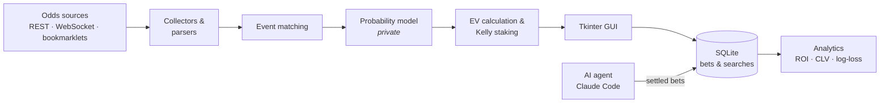

# Sports Odds Value Analysis

A desktop application that compares odds from multiple betting sites against a proprietary probability model, flags positive expected-value (EV) opportunities and tracks every bet for performance analytics.

> **Note:** This repository is a project showcase. The source code and the probability model are kept private.

---

## Overview

Betting odds differ between sites, and they move constantly. The application gathers current odds from several sources, matches the same events across them and estimates a fair probability for each outcome. It then highlights bets where a site's odds are higher than the fair odds, which means the bet has positive expected value.

Every bet placed is stored, so the model's real performance can be measured over time with ROI, closing line value (CLV) and calibration metrics.

## Results

| Metric | Value |
|---|---|
| Bets tracked | 1,800+ |
| Average closing line value (CLV) | approx. **+5%** |
| Bets placed at better odds than the closing price | **~80%** |
| Automated tests | ~140 |

CLV compares the odds a bet was placed at with the final market price just before the event. A consistently positive CLV is the most reliable short-term sign that the model finds real value and isn't just lucky.

## Features

- **Multi-source odds collection.** Collects odds through REST APIs, a WebSocket feed and browser-based JavaScript collectors (bookmarklets) for sites without a public API.
- **Event matching.** Matches the same event across sources despite different team and player names, time zones and market formats (moneyline, totals, handicaps).
- **Value detection.** Calculates EV for every outcome and highlights playable bets, with filters per site, sport, market type and minimum EV.
- **Stake sizing.** Calculates bet sizes and bankroll management
- **Bet tracking.** Stores bets and search history in SQLite, then shows ROI, profit, CLV and hit rate by site, sport and market.
- **AI-assisted result import.** A single button starts an AI agent (Claude Code) that reads settled bets from the user's betting accounts in the browser. The application then matches them to open bets and settles them automatically, with a report of anything ambiguous.
- **Model validation.** Compares the accuracy of different odds sources against actual outcomes using log-loss.
- **Packaged desktop app.** Built with a Tkinter GUI and packaged as a single Windows executable with PyInstaller.

## Architecture

## Tech stack

| Area | Tools |
|---|---|
| Language | Python, JavaScript |
| Data | SQLite (~500 MB), JSON |
| Networking | REST APIs, WebSocket (socket.io), HTTP caching and rate limiting |
| UI | Tkinter |
| Testing and packaging | pytest, PyInstaller |
| AI | Claude Code (agentic, AI-assisted development and result import) |

## Engineering highlights

- **Stale data.** One site's REST API served odds from a cache that was out of date. I solved this by analysing the site's own WebSocket traffic and subscribing to live odds updates directly.
- **API limits.** Free API tiers allow only a limited number of requests, so the app uses request counters, response caching, TTLs and failure backoff to stay within them.
- **Safe automation.** The AI agent works from a written guide that limits it to reading results. It cannot place bets or move money, and the database is backed up automatically before every import.
- **My role.** I built the project with AI-assisted development tools. I was responsible for the requirements, architecture decisions, testing and validating the results.

## Screenshots

### Value search

### Bet tracking & CLV

### Statistics

### AI-assisted result import

